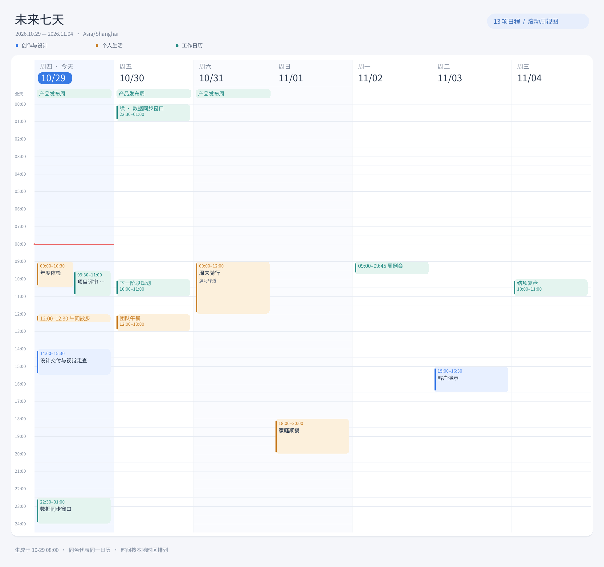

# radicale-extend

Go 编写的 [Radicale](https://radicale.org/v3.html) 扩展服务器，通过 MCP（Model Context Protocol）管理日程和待办，并使用 SMTP 邮件或 Telegram 发送变更通知和到期提醒。

这是一个**无前端页面的单用户服务器应用**。Radicale 继续负责 CalDAV 数据和权限，Go 服务负责 MCP、调度和消息投递，Python 仅用于最小 Hook 插件。兼容基线固定为 **Radicale 3.9.0**，无须修改其上游代码。

典型流程：让 AI 创建日程，在手机日历中同步和修改，到指定时间收到个人邮件或 Telegram 提醒。

## 目录

- [能力与边界](#能力与边界)
- [Docker Compose 部署](#docker-compose-部署)
- [配置参考](#配置参考)
- [命令行参考](#命令行参考)
- [开发与测试](#开发与测试无本地-docker)
- [GitHub Actions 与 GHCR](#github-actions-与-ghcr)
- [常见问题](#常见问题)
- [可靠性说明](#可靠性说明)
- [项目结构](#项目结构)
- [验证范围](#验证范围)

## 工作方式

```text
MCP 客户端 -> Go 服务 -> CalDAV -> Radicale <- 手机/桌面日历
                                  |
                          Python Hook -> SQLite 事件队列
                                             |
                          Go Worker -> 提醒/投递任务 -> SMTP、Telegram
                          周期 DAV 同步校验 ------^
```

Hook 将原始变更快速写入本地队列，Go Worker 再通过 CalDAV 读取当前状态、生成提醒和发送消息。邮件与 Telegram 网络请求不会在 Radicale 的同步请求中执行。客户端通过正常 CalDAV 接口使用 Radicale，MCP 客户端连接 Go 服务。

## 能力与边界

- 单个 DAV 账号；HTTP MCP 使用独立 Bearer Token，另支持 stdio。
- 14 个 MCP 工具，覆盖日历列表、日程与待办管理、完成待办、提醒覆盖和状态查询。
- RRULE、RDATE、EXDATE、RECURRENCE-ID 单次改期/删除，IANA 时区、夏令时、浮动时间和全天事件。
- VALARM 相对开始/结束、绝对时间、REPEAT/DURATION；原提醒收件人不会被用作消息接收者。
- SQLite 持久化、任务租约、独立渠道重试、变更合并、免打扰和隐私隐藏。
- 每天 08:00（可配置）发送今天起连续七天的日历 PNG；支持 SMTP 内嵌图片／附件及 Telegram 图片，Bot `/week` 可手动触发。
- 提醒顺序：服务端显式覆盖/关闭 > VALARM > 默认提前 15 分钟。无提醒的全天事件当天 09:00 通知，默认时区 Asia/Shanghai。
- 不包含联系人管理、多用户、会议邀请邮件、Telegram 按钮及 OAuth 自动发现；HTTP 客户端需要能自行配置 Authorization 请求头。
- 不支持自定义 VTIMEZONE 时区定义、RDATE PERIOD、RECURRENCE-ID RANGE 等高级提醒语义，原数据保留，调度报告不支持并取消该资源的待发提醒，不进行猜测。Radicale 本身仍可存储这些数据。
- VJOURNAL 由 Radicale 保管，本服务不调度。没有 DTSTART/DUE 的待办可创建、查询和完成，但没有时间提醒。

## Docker Compose 部署

以下 Docker 命令用于部署服务器或 GitHub Runner。**项目的本地开发测试不运行 Docker。**

部署服务器需要 Docker Engine、支持 `docker compose` 命令的 Compose 插件，以及用于初始化凭据的 Python 3.11+。使用发布镜像时，服务器无需安装 Go。

先确认两个 GHCR 镜像已经发布。下文的 `your-owner`、`your-repo` 和 `0.1.0` 都是示例，需要替换成实际仓库和已发布标签；本 README 不表示示例地址已有可用镜像。发布步骤见 [GitHub Actions 与 GHCR](#github-actions-与-ghcr)。

### 1. 准备配置和凭据

在目标服务器下载本项目部署文件。使用 Python 创建独立环境并生成凭据：

```sh
python3 -m venv .venv
.venv/bin/python -m pip install bcrypt==4.3.0
.venv/bin/python scripts/init_secrets.py --username alice
cp .env.example .env
cp config.example.yaml config.yaml
```

Windows 可使用 `.venv\Scripts\python.exe` 和对应的文件复制命令。

项目内的 `.env`、`config.yaml`、`secrets/`、数据库及测试缓存已加入 `.gitignore`；示例配置可以提交，真实配置和凭据不应提交。

生成器创建随机 DAV 密码、MCP Token、bcrypt 用户文件及空的渠道密钥文件，已有文件时拒绝覆盖。`secrets/` 目录为 0700，单个文件为 0644，使容器 UID 10001 能读取文件挂载；宿主机通过父目录限制访问。不要将目录整体改成公开可读。Windows 下另用 NTFS ACL 限制目录访问。

编辑 `.env`：

```dotenv
APP_IMAGE=ghcr.io/your-owner/your-repo
RADICALE_IMAGE=ghcr.io/your-owner/your-repo-radicale
IMAGE_TAG=0.1.0
APP_CONFIG=./config.yaml
SECRETS_DIR=./secrets
DAV_USERNAME=alice
```

镜像名必须与 GitHub 仓库标识的小写形式一致。`DAV_USERNAME`、生成器的用户名以及日历路径需要一致。默认只向宿主机 `127.0.0.1` 发布 5232 和 8080。

### 2. 配置消息渠道

可以只启用一个渠道，也可以同时启用。编辑 `config.yaml` 的对应配置块，保持其他配置不变。

SMTP 示例：

```yaml
smtp:
  enabled: true
  host: smtp.example.com
  port: 587
  security: starttls
  username: calendar@example.com
  password:
    file: /run/secrets/smtp_password
  from: calendar@example.com
  to: me@example.com
```

Telegram 示例：

```yaml
telegram:
  enabled: true
  commands_enabled: true
  token:
    file: /run/secrets/telegram_token
  chat_id: '123456789'
  api_url: https://api.telegram.org
```

设置时注意：

- 邮件：设置 `smtp.enabled: true`、host、port、security、username、from、to；密码写到 `secrets/smtp_password`。默认 STARTTLS，TLS 证书必须有效；使用 `security: tls` 对接隐式 TLS。`none` 只适合可信的无认证内网中继。
- Telegram：向 BotFather 创建 Bot，把 Token 写入 `secrets/telegram_token`；先向 Bot 发送 `/start`，通过 Bot API 的 `getUpdates` 确认自己的 `chat.id`，再配置 `telegram.chat_id` 和 `enabled: true`。不要把 Token 或更新内容粘贴到公共日志。

两个渠道默认关闭，启用后只通知显式配置的接收者。所有密钥文件避免尾部多余空格，尾部换行会被移除。

设置 `telegram.commands_enabled: true` 后，`serve` 入口同时运行 Bot 命令接收器，并为绑定的私人聊天注册命令菜单：

| 命令 | 功能 |
| --- | --- |
| `/today` | 按 `timezone` 查询今天 00:00 至明天 00:00 的日程，包含全天、跨天、重复实例和今天已结束的日程 |
| `/next [N]` | 查询从现在起最近的 N 个日程；N 为 1–20 的整数，省略默认 5 条。按开始时间排序，包含进行中的日程；搜索范围为未来 366 天 |
| `/week` | 生成今天起连续七天的周视图 PNG，经已启用的 SMTP／Telegram 渠道发送 |
| `/event ID` | 查看选中事件及 SMTP、Telegram 的提醒规则和渠道状态 |
| `/title ID 新标题` | 修改选中的事件标题；重复日程默认只修改选中的那一次 |
| `/remind ID smtp\|telegram\|all 15m\|off\|default` | 修改提醒规则：分渠道设置提前量、关闭提醒或恢复继承 |
| `/title_series ID 新标题` | 修改整个重复系列及其单次例外的标题 |
| `/remind_series ID smtp\|telegram\|all 15m\|off\|default` | 为整个事件／系列设置提醒；已有单次实例覆盖仍优先 |
| `/help`、`/start` | 显示命令与时区说明 |

也可发送“今日日程”“今天的日程”或“最近5个日程”。命令直接通过 DAV 查询所有授权日历，不受通知渠道开关或 30 天提醒生成窗口限制；取消的日程和待办不会列入。详情隐藏规则 `hide_details` 同样生效。当天超过 100 个实例时只显示最早的 100 个并明确提示，长列表自动分条发送。用户主动查询立即回复，不延后到免打扰时段结束。

列表中的每个事件会显示一个可复制的 ID，有效期为 24 小时，与 Bot／接收者及具体重复实例绑定；重启后仍可使用。下面以列表中的实际 ID 替换 `事件ID`：

```text
/next
/next 20
/event 事件ID
/title 事件ID 修改后的会议标题
/remind 事件ID smtp 30m
/remind 事件ID telegram 10m
/remind 事件ID telegram off
/remind 事件ID all default
```

提前量支持 Go 时间长度形式，例如 `0s`（开始时提醒）、`15m`、`1h30m`、`24h`，精确到秒，范围为 0 至 366 天。每个渠道、每个修改范围设置一个提前量；`off` 关闭当前范围的提醒，`default` 删除当前范围的覆盖并恢复继承。优先级为：**单次实例的渠道覆盖 > 整个系列的渠道覆盖 > MCP 的事件级覆盖 > 日历 VALARM > 默认提醒**。规则和重建的投递任务在同一 SQLite 事务提交，旧提醒会撤销；DAV 同步及重启不会清除规则。此设置只影响定时提醒，不改变变更通知。

对重复日程，普通 `/title` 和 `/remind` 仅处理 ID 指向的那一次；明确使用 `_series` 命令才处理整个系列。系列标题修改会同步更新例外实例的标题，其他属性、组件和 VALARM 保留。标题长度为 1 至 200 字。Bot 使用列表所记录的 ETag 发出条件更新；其他客户端修改过的资源会被拒绝，需重新获取列表。修改标题成功后当前 ID 可继续设置提醒，其他实例的旧 ID 需要刷新。

Bot 管理的是个人事件提醒规则，不提供 SMTP 账号、收件人、密码或 Telegram Token 配置。全局未启用的渠道以及日历白名单、渠道白名单、`reminders: false`、详情隐藏和免打扰规则仍然有效。可以提前保存未启用渠道的规则，Bot 会明确显示“不会发送”；需在服务端配置并启用 SMTP 后邮件才会投递。已取消、已删除、已完成或已过期的提醒不会因设置规则而强行补发。

标题写入 DAV 与本地回复确认不能形成同一事务。若请求结果不确定，Bot 会提示刷新列表核对，不宣称已回滚远端日程；重复处理同一标题通常会成为无改动操作。业务库新增 `telegram_event_refs` 和 `channel_reminders` 表，不改变 Hook 协议。当前这些功能已通过本地替身服务、原生 Radicale 3.9.0 和竞态测试；本次未进行服务器验证或更新服务器部署。

查看事件及提醒规则时先从 `/today` 或 `/next` 复制事件 ID，再发送 `/event ID`。查询会明确区分“提前量覆盖”“关闭”“日历自带 VALARM”和“服务端默认”：普通默认显示具体提前量（通常 15 分钟），无 VALARM 的全天默认显示当天时刻（通常 09:00）。每个渠道都会显示规则来源、是否启用，以及按配置时区计算的触发时间；多个触发只展示最早 3 次并给出总数。不支持的日历提醒明确报告解析状态，不猜测时间。触发时间描述规则本身，实际发送仍受免打扰、宽限期、渠道开关和投递状态影响；此查询不会修改日程、提醒规则或创建日程提醒任务。修改规则统一使用 `/remind ID ...`。

命令功能默认关闭，仅支持配置的数字私人 `chat_id`；其他用户、群组、编辑消息和指向其他 Bot 的命令都不会触发查询。它使用 Telegram [getUpdates 长轮询](https://core.telegram.org/bots/api#getupdates)，不需要新增公网端口。同一 Token 只能由一个本服务实例接收更新；已设置 webhook 时会记录冲突并重试，不自动删除 webhook。启用前先停止其他轮询程序，必要时自行解除原 webhook；`mcp-stdio` 不接收 Bot 命令。

更新游标和回复队列保存在现有业务 SQLite 中，以事务同时记录，重启后继续处理；每条回复独立重试，最多 8 次，并遵守 `retry_after`。多条回复按原顺序投递；已成功或最终失败的回复正文会被清空。超过 10 分钟的旧命令会跳过。网络发送成功但本地尚未确认时崩溃，仍可能重复回复。`/readyz` 的 `telegram_pending_replies` 和 `telegram_failed_replies` 可检查回复积压或失败，日志不记录收到的私人消息或 Token。上述表是业务数据库的兼容性新增表，不改变 Hook 队列协议。

每天自动发送的七天日程图：

```yaml
weekly:
  enabled: true
  at: '08:00'       # 使用 timezone；默认 Asia/Shanghai
  channels: [smtp, telegram]
  catch_up: 1h     # 08:00–09:00 内可补发；之后跳过，等下一天
  max_events: 500  # 1–2000，超量会在图片中标注
  font_file: /usr/share/fonts/opentype/noto/NotoSansCJK-Regular.ttc
  font_index: 2    # 配套 Noto 字体合集中的简体中文
```

图片以请求所在日期为第一列，连续七个自然日，例如周三至下周二；横向日期、纵向时间。按日历固定配色，全天事件置顶、跨天事件拆成每日色块、重叠事件并列显示。时间轴默认 07:00–22:00，有夜间日程时自动扩展至相应时段。过于密集的重叠块或全天事件以 `+N` 标记，完整信息仍可用 Bot 查询或日历客户端查看。周视图包含重复实例和单次例外，排除已取消事件与待办，遵守集合白名单、日历渠道限制和 `hide_details`；关闭某个事件的定时提醒不会把它从日程概览中删除。



`weekly.enabled` 默认 `true`，时间默认 `08:00`，**已有配置省略 weekly 时也采用此默认值**。仅在全局已启用的渠道发送，不自动配置 SMTP 或修改 Telegram 接收者。设为 `false` 只关闭每日自动发送，手动 `/week` 仍可使用。每日任务在配置时区按日期去重，重启不会重新发送已经成功的渠道；恢复时间超出 `catch_up` 则跳过旧的每日图片。自定义时间恰逢夏令时不存在的本地时刻时跳过当天；重复出现的本地时刻仍只创建一份日报。

手动 `/week` 仅响应绑定的私人聊天，立即入持久化队列，向 `weekly.channels` 中全局已启用的渠道发送。请求至少间隔一分钟，重复接收同一个 Telegram 更新不会重复入队，最多保留 20 份正在生成／待发的图片请求。自动发送遵守免打扰，手动请求立即处理；图片到期后不继续投递。SMTP 邮件包含纯文本、可内嵌图片的 HTML 和 PNG，Telegram 使用 [sendPhoto](https://core.telegram.org/bots/api#sendphoto)。每个渠道独立重试，最多 8 次，遵守 Telegram `retry_after`；远端成功、本地尚未确认时崩溃仍可能重复发送。

Go 直接绘制固定 1960×1840 画布，串行处理生成和投递，不启动浏览器、不使用 Python 绘图。画布约 13.8 MiB，PNG 上限 4 MiB；两个渠道可使用同一幅图时只绘制一次。周图查询采用带时区缓冲的 CalDAV 时间过滤，每个查询响应上限 32 MiB，避免加载整份历史日历。默认最多展示 500 个实例，超量或无法可靠解析时明确标注或报告，不静默猜测。开发机的 13 条中文模拟日程样张约 63 ms、PNG 166 KiB、单次累计分配约 16.4 MiB；这是样本基准，包含真实查询的服务总 RSS 和峰值仍会受日历规模、字体和 Go 运行时影响。

请求和待发 PNG 保存在现有业务 SQLite，租约支持重启恢复；每个渠道成功、失败、取消或过期后清空其图片字段，数据库空间可复用，终态元数据保留七天。配置中的接收者或隐私／渠道策略改变后，旧图片任务会取消，需重新生成。`/readyz` 的 `weekly_pending`、`weekly_failed` 可用于排查积压或失败；日志不输出图片、日程标题或凭据。保持业务状态卷即可持久化图片队列，无需新增 Compose 卷或公网接口。

生成过程不创建临时 PNG 文件。发送成功立即清空对应渠道的图片；仅待重试的渠道保留图片，到期由启动及每分钟的清理任务清空，即使下次重试时间尚未到达。清理不会中断仍持有有效租约的发送，崩溃遗留的图片在租约结束后回收。每小时在图片队列空闲时尝试截断业务库 WAL，WAL 重置后的保留大小目标为 8 MiB（活跃事务期间可能暂时超过）。主数据库的空闲页供后续图片复用，文件大小可能保持历史峰值，不会按每日图片数量持续累加；运行期间不执行重写整个数据库的 `VACUUM`。

配套 Go 镜像包含 [Noto CJK](https://github.com/notofonts/noto-cjk) 简体中文字体及许可证。原生运行需自行提供可信的中文 TTF／OTF／TTC 文件，并调整 `font_file`、`font_index`（单字体文件通常为 0）；字体缺失或格式不支持时，图片任务会失败并重试，不影响 DAV 和普通通知。图片是生成时的快照，投递重试复用该快照；需要最新修改时再次发送 `/week`。

本地验证只使用替身 SMTP／Telegram、临时 SQLite、原生 Radicale 和合成日程；不调用本地 Docker，也不向真实渠道发送测试图片。GitHub Runner 才负责镜像构建及容器字体安装验证。当前功能尚未在部署服务器验证或上线。

按日历配置规则时，`calendars` 同时充当服务的集合白名单；留空表示该用户主页中可发现的所有日历：

```yaml
calendars:
  - path: /alice/work/
    channels: [smtp, telegram]
    changes: true
    reminders: true
    hide_details: false
quiet:
  start: '22:00'
  end: '08:00'
```

省略 `channels` 表示全部已启用渠道，空数组表示不发送。免打扰默认关闭。免打扰结束时已经超过提醒宽限期的消息标记过期，变更通知则延后发送。配置修改后重启 Go 服务生效。

### 3. 启动

公开镜像可直接拉取；私有 GHCR 镜像需要先在部署服务器登录 GHCR，并确保账户具有读取包的权限：

```sh
docker compose pull
docker compose up -d --no-build
docker compose ps
docker compose logs -f app radicale
```

启动顺序为数据库初始化任务成功、Radicale 健康、Go 服务启动并完成首次同步。容器均使用 UID/GID `10001:10001`，卷分别保存 Radicale 数据、事件队列和 Go 状态。不要将 SQLite/WAL 放在 NFS 等网络文件系统。

尚未发布镜像时，可以在部署服务器用 `docker compose build` 构建，然后 `docker compose up -d`；这不属于项目的本地测试流程。

首次启动没有日历是正常情况。用 CalDAV 客户端创建日历，或在服务器创建集合：

```sh
curl --user alice -X MKCALENDAR \
  -H 'Content-Type: application/xml' \
  --data '<c:mkcalendar xmlns:c="urn:ietf:params:xml:ns:caldav"/>' \
  http://127.0.0.1:5232/alice/work/
```

密码取自 `secrets/dav_password`。MCP 工具操作已有集合，不创建日历。配置日历白名单后，只能操作其中可发现的集合。

远程客户端应通过 HTTPS 反向代理访问。将代理连接到 Compose 网络，或转发宿主机回环端口；保留 Authorization 和 MCP 协议请求头，并禁止代理缓存 MCP 响应。Radicale Web 插件设为 `none`，不提供管理页面。

### 4. MCP 接入

配置 HTTP 地址 `https://your-server/mcp`，请求头 `Authorization: Bearer <mcp_token 文件内容>`。不要使用 DAV 密码代替 MCP Token。

工具及参数：

| 工具 | 参数 |
| --- | --- |
| `list_calendars` | 无 |
| `search_events` / `list_tasks` | `calendar`、`from`、`to`、可选 `query`、`limit` |
| `get_event` / `get_task` | `resource`、可选 `recurrence_id` |
| `create_event` / `create_task` | `calendar`、`fields` |
| `update_event` / `update_task` | `resource`、`etag`、`fields`、可选 `recurrence_id` |
| `delete_event` / `delete_task` / `complete_task` | `resource`、`etag`、可选 `recurrence_id` |
| `set_reminder` | `resource`、`mode: calendar/off/before`、可选 `before_seconds` |
| `list_reminders` | `resource` |

`fields` 支持 summary、description、location、status、start、end（事件）、due（待办）、all_day、timezone、rrule、rdates、exdates。时间使用带偏移量的 RFC3339；全天使用 YYYY-MM-DD。`timezone` 表示储存时间的 IANA 时区，省略则使用配置时区。省略字段保留原值，空字符串用于清除可选文本/时间或 RRULE，空数组清除 RDATE/EXDATE。

搜索时间段为 `[from,to)`，最长 366 天，默认返回 100 项，最大 1000 项；生成实例有额外总量限制。待办默认包含无日期任务，可传 `include_undated: false` 关闭；已完成项默认隐藏，可传 `include_completed: true` 查看。

例如 `create_event` 的参数：

```json
{
  "calendar": "/alice/work/",
  "fields": {
    "summary": "项目例会",
    "start": "2026-11-02T10:00:00+08:00",
    "end": "2026-11-02T11:00:00+08:00",
    "timezone": "Asia/Shanghai",
    "rrule": "FREQ=WEEKLY;BYDAY=MO"
  }
}
```

更新和删除必须使用最近一次读取返回的完整 `etag`（包括引号）。收到 412 后重新读取，由调用者解决并发冲突。`recurrence_id` 使用原实例标识：改期后仍使用原定时间，不使用改期后的时间；省略会作用于整个系列。单次修改不能包含系列规则字段。

`set_reminder` 是按日历+UID 的服务端覆盖，不改写日历中的 VALARM；`calendar` 清除覆盖效果，恢复 VALARM/默认规则。提醒状态查询返回 `jobs`、是否已同步的 `synchronized` 及可选的 `scheduling_error`；任务时间为 UTC Unix 时间戳，不返回消息正文，最多列出 1000 项并优先展示活动任务。

本地 stdio 客户端配置示例：

```json
{
  "mcpServers": {
    "calendar": {
      "command": "/path/to/radicale-extend",
      "args": ["mcp-stdio", "--config", "/path/to/config.yaml"]
    }
  }
}
```

stdio 模式不会启动后台 Worker，仍需独立运行 `serve` 并使用同一组数据库路径。首版按单个 `serve` 实例部署，不配置多个调度副本。日志只写 stderr，stdout 用于 MCP 协议。

### 5. 健康检查、升级和备份

- `/healthz` 返回进程存活状态；`/readyz` 返回数据库连接、最近同步和积压/失败计数，不含日程正文。
- `docker compose stop` 停止；`docker compose down` 移除容器并保留卷。**不要用 `down -v` 删除业务数据。**
- 升级前备份，然后修改 `.env` 的 IMAGE_TAG，运行 `docker compose pull` 和 `docker compose up -d --no-build`。schema/protocol 不兼容会报错；v1 不自动执行破坏性降级。
- 一致性备份先停止 app、radicale，再备份三个命名卷及配置、凭据。保留整个 SQLite 目录，不能只复制 `.db` 而忽略 WAL。恢复时停止服务，恢复三个卷、配置和凭据，确认 UID/GID 为 10001，再启动。
- 日志中可按 job ID、channel 和 attempt 排查失败。任务最多尝试 8 次，退避上限 1 小时，Telegram 遵守 retry_after；终止失败任务保留供检查，本版没有管理页面或手动重放工具。

### 连接已有 Radicale

在已有 Radicale 的 Python 环境中安装 `hook/` 包，配置 `[hook] type = radicale_extend_hook`，并将 `RADICALE_EXTEND_QUEUE` 指向初始化完成的队列库。

Go 使用 `init-db --config ...` 初始化数据库，之后再启动 Radicale。两个进程需共享同一主机的本地队列目录和读写权限，不能只共享 `.db` 文件。调整 DAV URL、home、账号和密码后运行 Go `serve`。不需要同步挂载 Radicale 的业务存储目录。

注意：上游加载 Hook 失败时会降级到 `none`；配套镜像在启动前额外检查插件和协议，外部部署也应检查启动日志。

## 配置参考

部署示例见 [config.example.yaml](config.example.yaml)，原生运行示例见 [config.local.example.yaml](config.local.example.yaml)，Compose 变量见 [.env.example](.env.example)。

### 服务配置

下面列出未显式配置时的程序默认值。Compose 示例另将监听地址设为 `0.0.0.0:8080`，并将数据文件放入 `/data` 下的持久化卷。

| 配置项 | 程序默认值 | 作用 |
| --- | --- | --- |
| `listen` | `127.0.0.1:8080` | HTTP MCP 和健康检查的监听地址 |
| `dav.url` / `dav.username` | 必填 | DAV 服务地址及单用户账号 |
| `dav.home` | DAV 基础路径下的用户目录 | 可选的日历主页路径 |
| `storage.state` | `data/state.db` | 快照、规则、提醒和投递状态库 |
| `storage.queue` | `data/queue.db` | Python Hook 与 Go 共用的事件队列库 |
| `timezone` | `Asia/Shanghai` | 浮动时间的解释、消息显示及免打扰时区 |
| `sync_interval` | `5m` | 周期同步间隔，至少 1 秒 |
| `debounce` | `30s` | 连续变更通知的合并等待时间 |
| `reminder.default_before` | `15m` | 没有 VALARM 或服务端覆盖时的提前量 |
| `reminder.all_day_at` | `'09:00'` | 没有显式提醒的全天事件通知时刻 |
| `reminder.horizon_days` | `30` | 提醒生成窗口，允许 1～366 天 |
| `reminder.max_instances` | `10000` | 实例展开数量限制，允许 1～100000 |
| `reminder.grace` | `10m` | 提醒迟到补发的宽限期 |
| `smtp.enabled` / `telegram.enabled` | `false` | 渠道必须显式开启 |
| `telegram.commands_enabled` | `false` | 启用私人聊天的 `/today`、`/next`、`/help` 命令；需要 Telegram 已开启 |
| `weekly.enabled` / `weekly.at` | `true` / `'08:00'` | 自动七天日程图及配置时区中的发送时刻 |
| `weekly.channels` | `[smtp, telegram]` | 仅在对应全局渠道也启用时发送 |
| `weekly.catch_up` | `1h` | 自动补发窗口及单次图片请求的有效期，1 分钟至 24 小时 |
| `weekly.max_events` | `500` | 周图事件上限，允许 1–2000 |
| `weekly.font_file` / `weekly.font_index` | 配套 Noto CJK TTC / `2` | 中文字体路径及合集索引，单字体文件通常设 0 |

时间间隔使用 Go duration 格式，例如 `30s`、`5m`、`24h`，不能写成 `1d`。两个数据库路径必须不同。配置含未知字段时会报错，修改配置后需要重启服务。

### 环境变量和密钥

| 环境变量 | 对应配置 |
| --- | --- |
| `MCP_TOKEN` / `MCP_TOKEN_FILE` | `token.value` / `token.file` |
| `DAV_PASSWORD` / `DAV_PASSWORD_FILE` | `dav.password.value` / `dav.password.file` |
| `SMTP_PASSWORD` / `SMTP_PASSWORD_FILE` | `smtp.password.value` / `smtp.password.file` |
| `TELEGRAM_TOKEN` / `TELEGRAM_TOKEN_FILE` | `telegram.token.value` / `telegram.token.file` |
| `DAV_URL` | `dav.url` |
| `DAV_USERNAME` | `dav.username` |
| `DAV_HOME` | `dav.home` |
| `TELEGRAM_CHAT_ID` | `telegram.chat_id` |
| `LISTEN` | `listen` |
| `RADICALE_EXTEND_QUEUE` | 仅供 Python Hook 使用，指定共用队列库文件 |

密钥优先级为：非空的 `*_FILE` 环境变量 > 已设置的直接值环境变量 > YAML 中的 `file` > YAML 中的 `value`。密钥文件只移除尾部换行，不移除空格。YAML 配置中的密钥文件即使所属渠道关闭也会读取，因此使用 Compose 示例时需要保留初始化脚本创建的空文件。

`.env` 用于 Compose 的变量替换，Go 程序**不会自动读取 `.env`**。若希望向容器传递表中的额外环境变量，需要在 Compose 的 `environment` 中显式配置；现有 Compose 只显式转发 `DAV_USERNAME`，其他凭据通过文件挂载提供。

### Compose 服务与数据

| 服务 | 职责 | 持久化卷 |
| --- | --- | --- |
| `init` | 初始化和检查数据库，成功退出属于正常状态 | `state`、`queue` |
| `radicale` | DAV 服务和 Python Hook | `radicale`、`queue` |
| `app` | Go MCP、同步、调度和消息投递 | `state`、`queue` |

`APP_CONFIG` 和 `SECRETS_DIR` 是部署服务器上的路径；`config.yaml` 中的 `/run/secrets/...`、`/data/...` 是容器内路径。不要将两者混用。通过 `MCP_BIND`/`MCP_PORT` 和 `DAV_BIND`/`DAV_PORT` 调整宿主机的绑定地址和端口。

## 命令行参考

命令格式为 `radicale-extend <命令> [参数]`，`--config` 应放在子命令后。省略子命令时默认运行 `serve`，配置文件默认为当前目录的 `config.yaml`。

| 命令 | 行为 |
| --- | --- |
| `serve --config config.yaml` | 启动 HTTP MCP、Worker、提醒调度和周期同步 |
| `mcp-stdio --config config.yaml` | 仅启动 stdio MCP，不启动后台任务 |
| `check-config --config config.yaml` | 读取配置和密钥并校验格式；不测试 DAV 或渠道的连通性 |
| `init-db --config config.yaml` | 创建或检查两个数据库及协议版本，不连接 DAV |
| `healthcheck --url http://127.0.0.1:8080/readyz` | 检查就绪状态；失败以非零状态退出，无须读取配置文件 |

## 开发与测试（无本地 Docker）

需要 Go 1.27 和 Python 3.11+；CI 使用 Python 3.13。复制 `config.local.example.yaml` 到 `config.yaml`，通过 `DAV_PASSWORD`、`MCP_TOKEN` 配置凭据。HTTP Token 至少 32 字节。也支持相应的 `*_FILE`，文件设置优先于直接环境变量，环境设置优先于 YAML。

原生运行前，需要有可访问的 Radicale。使用 Hook 时先执行 `init-db`，再在 Radicale 进程中配置 `RADICALE_EXTEND_QUEUE` 和插件；连接现有实例时按前文完成适配。仅运行单元测试不需要预先运行 Radicale，原生集成测试会自行启动临时进程。

Linux/macOS：

```sh
go build -o bin/radicale-extend ./cmd/radicale-extend
go run ./cmd/radicale-extend check-config --config config.yaml
go run ./cmd/radicale-extend init-db --config config.yaml
go run ./cmd/radicale-extend serve --config config.yaml
```

测试安装和运行：

```sh
python3 -m venv .venv
.venv/bin/python -m pip install ./hook bcrypt==4.3.0 PyYAML==6.0.3
RADICALE_PYTHON="$PWD/.venv/bin/python" go test ./... -count=1
go vet ./...
.venv/bin/python -m unittest discover -s hook/tests -v
.venv/bin/python scripts/check_assets.py
```

未设置 RADICALE_PYTHON 时，原生 Radicale 集成测试会明确跳过；CI 显式设置并运行。源码直接测试 Hook 时设置 `PYTHONPATH=hook`。Windows 可设置 TEMP/TMP 为项目内 `.cache/tmp`，避免受限制的系统临时目录；套接字测试要求系统允许回环连接。

CLI 另提供 `healthcheck --url http://127.0.0.1:8080/readyz`。数据库初始化和配置检查不会启动 HTTP 或 Worker。

Windows PowerShell 测试示例：

```powershell
python -m venv .venv
.\.venv\Scripts\python.exe -m pip install ./hook bcrypt==4.3.0 PyYAML==6.0.3
New-Item -ItemType Directory -Force .cache/tmp | Out-Null
$env:TEMP = (Resolve-Path .cache/tmp).Path
$env:TMP = $env:TEMP
$env:RADICALE_PYTHON = (Resolve-Path .venv/Scripts/python.exe).Path
go test ./... -count=1
go vet ./...
.\.venv\Scripts\python.exe -m unittest discover -s hook/tests -v
.\.venv\Scripts\python.exe scripts/check_assets.py
```

在支持 CGO 且安装了 C 编译器的环境中，可再运行 `go test -race ./... -count=1`。Linux CI 会执行该检查。本地不运行 `tests/compose_smoke.py` 或 `docker compose config`；容器验证交给 GitHub Runner。

## GitHub Actions 与 GHCR

- CI：Go 格式/vet/竞态检查、Python Hook、原生 Radicale 集成、部署静态检查；GitHub Runner 额外构建两个镜像并运行 Compose 冒烟测试，用合成 SMTP/Telegram 服务验证投递和重启去重，不发送真实通知。
- 发布：推送代码到自己的 GitHub 仓库默认分支，在 Actions 选择 **Publish GHCR images → Run workflow**，输入 tag（如 `0.1.0`）。默认不更新 latest。
- 发布前复用完整 CI；通过后用 GITHUB_TOKEN 推送两套 linux/amd64、linux/arm64 镜像，同时生成 `sha-<完整提交SHA>` 标签、OCI 来源、SBOM 和构建来源证明。`latest` 和 `sha-*` 为保留输入标签。
- 勾选 update_latest 只允许从默认分支执行。所有 Action 引用固定到经过查询的提交 SHA。
- 工作流申请 contents:read、packages:write。组织策略需允许工作流发布包；已有同名包需给仓库 Actions 写权限。首次发布后在包设置中自行选择可见性；本工作流不更改可见性，不需要额外 PAT。
- 工作流汇总输出镜像摘要，部署可进一步固定到摘要。工作流需要将代码推送到 GitHub 后在对应仓库中运行，示例地址不代表镜像已经发布。

对于仓库 `YourOwner/radicale-extend`，发布 tag `0.1.0` 后的镜像名称为：

```text
ghcr.io/yourowner/radicale-extend:0.1.0
ghcr.io/yourowner/radicale-extend-radicale:0.1.0
```

仓库名称与上述示例不同时，两个镜像名称也会随之变化。普通 push、PR 和推送 Git 标签不会触发镜像发布；需要手动执行发布工作流。发布失败应先查看 `validate`、`checks` 或 `publish` 对应任务，再决定是否重试。

## 常见问题

| 现象 | 检查项 |
| --- | --- |
| `/mcp` 返回 401 | 请求头是否为 `Authorization: Bearer ...`，是否误用了 DAV 密码，Token 是否与服务配置一致 |
| DAV 返回 401/403 | 用户名、密码、bcrypt 用户文件及 Radicale 权限；修改生成的 DAV 密码时，用户文件中的哈希也必须同步更新 |
| 更新或删除返回 412 | 重新读取资源获取最新 ETag，再由调用者处理并发冲突，不使用 `*` 覆盖 |
| 服务未就绪，`/readyz` 返回 503 | 检查 `init` 是否成功、Radicale 是否健康，以及 DAV URL、账号和存储目录权限 |
| Hook 报队列不存在或协议错误 | 先运行 `init-db`，确认两端访问同一队列目录及 WAL 文件，且运行用户具有读写权限 |
| 没有收到通知 | 检查渠道是否开启、接收者/密钥、日历白名单、`channels`、免打扰时段及 VALARM/服务端覆盖优先级 |
| 只运行 stdio 时没有提醒 | 后台任务需要单独运行的 `serve`，两者必须使用一致的配置和数据库 |
| `list_reminders` 中有 `scheduling_error` | 检查时区、重复规则和实例数量；无法解释的语义不会生成猜测性提醒 |
| 提醒过期未发送 | 检查服务停机时长及 `reminder.grace`；超过宽限期的提醒不补发 |
| 镜像拉取失败 | 确认镜像已经发布、名称小写且 tag 存在；私有包还需要 GHCR 登录和读取权限 |

`/readyz` 会提供 `pending_jobs`、`failed_jobs`、`queued_events`、`failed_events` 和 `unsupported_resources` 计数。实际发送结果以任务状态及日志为准，配置检查成功并不表示 SMTP、Telegram 或 DAV 已经连通。

## 可靠性说明

首次同步建立基线，不发送已有日程的新建通知。Hook 只作为及时同步信号，Go 读取 DAV 的当前权威状态，默认每 5 分钟补偿校验并每小时延展提醒窗口；连续变化默认合并 30 秒。事件队列与业务库之间采用幂等处理及成功后确认，不承诺跨数据库事务。

提醒默认预生成未来 30 天内的触发时间，展开数量受限；改期、删除、取消、完成后撤销旧提醒。发送前重新读取 DAV，DAV 不可用则延后重试。重启补发默认最多迟到 10 分钟，超过宽限期不再发送。

手机写入和队列入队并非同一事务。进程崩溃可能漏掉历史中间变化；补偿可以恢复当前提醒状态，无法恢复全部历史通知。远端收件成功但本地尚未记录成功时崩溃也可能导致重复发送，属于至少一次投递的边界。不要将提醒用于依赖恰好一次投递的流程。

## 项目结构

```text
cmd/radicale-extend/   Go 命令行入口
internal/
  calendar/           iCalendar、重复实例和提醒解析
  config/             YAML、环境变量及密钥读取
  dav/                DAV 访问、地址限制和条件写入
  mcpapi/             MCP 工具和 HTTP 接口
  notify/             SMTP、Telegram 投递
  telegrambot/        私人聊天命令、长轮询与持久化回复队列
  week/               每日周图调度、请求去重、独立渠道重试
  weekimage/          固定画布周视图 PNG、中文字体与碰撞排版
  service/            同步、队列消费和调度
  store/              SQLite 数据库与任务状态
hook/                 独立 Python Hook 包和测试
integration/          原生 Radicale 集成测试
deploy/               Radicale 配置、启动和健康检查
scripts/              凭据初始化及静态检查
tests/                GitHub Runner 的 Compose 冒烟测试
.github/workflows/    CI 和手动 GHCR 发布
compose.yaml          配套部署入口
Dockerfile            app、radicale 两个镜像目标
```

开发约定见 [AGENTS.md](AGENTS.md)。Go 是核心业务语言，Python 限于适配、部署辅助和测试，不引入前端工程。

## 验证范围

本地检查不调用任何 Docker 命令。容器运行、多架构构建和 GHCR 发布依赖 GitHub 工作流实际执行；提供部署文件不代表这些远端操作已经成功。
